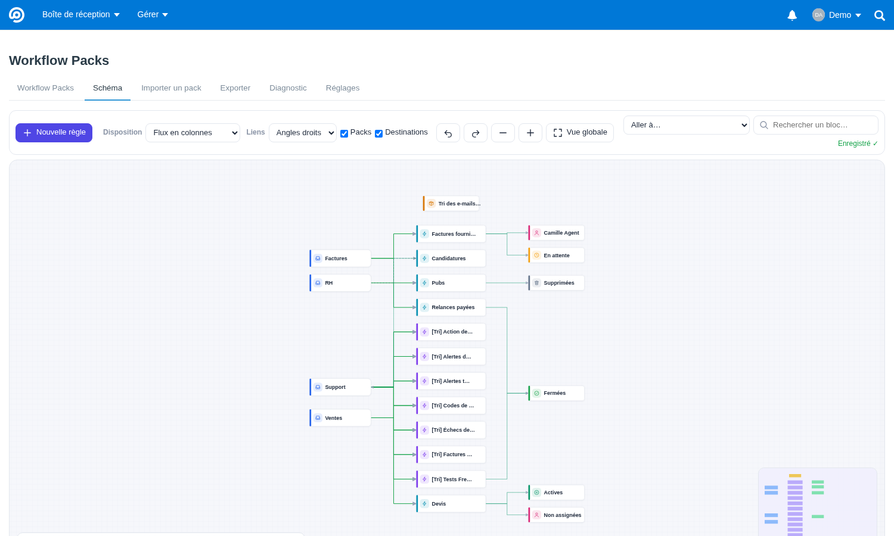
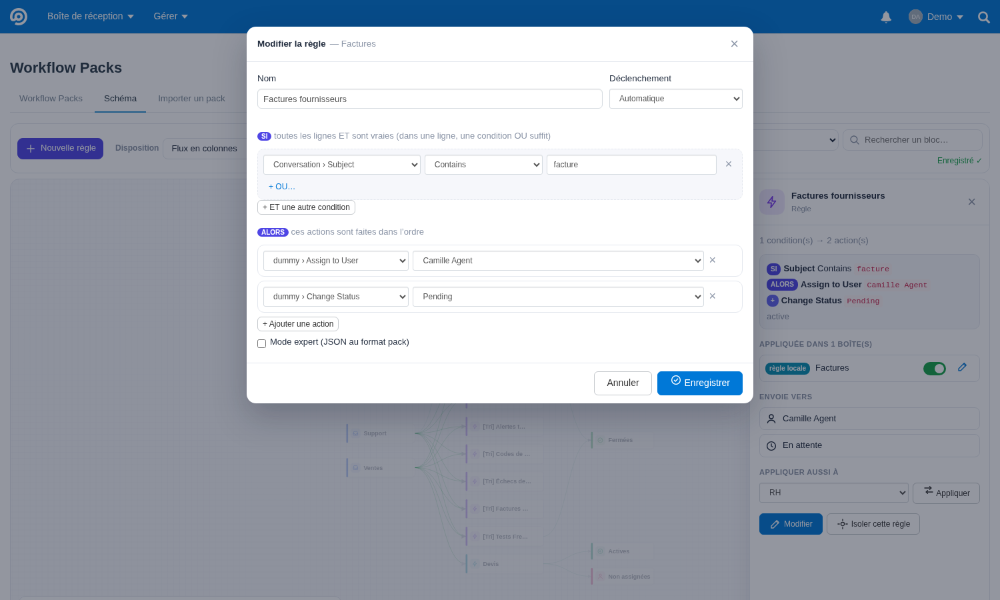
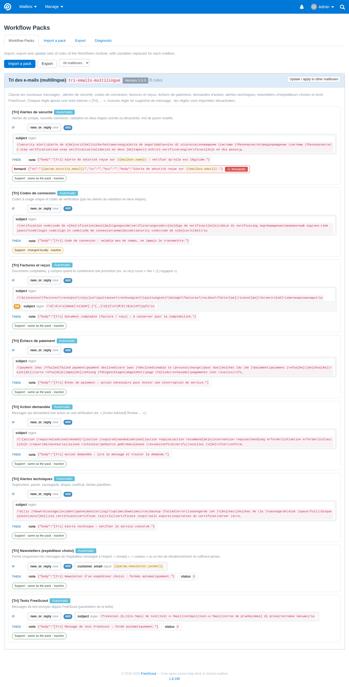
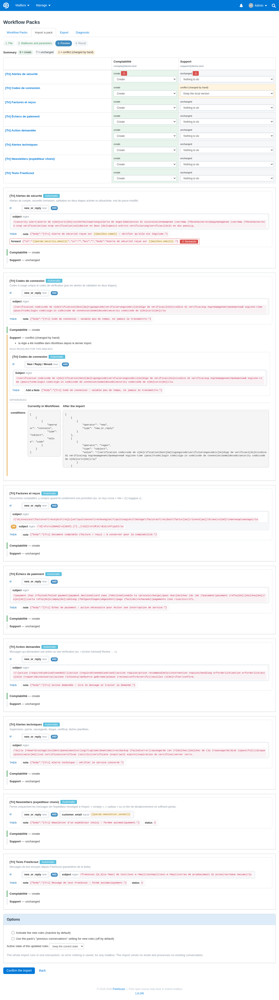
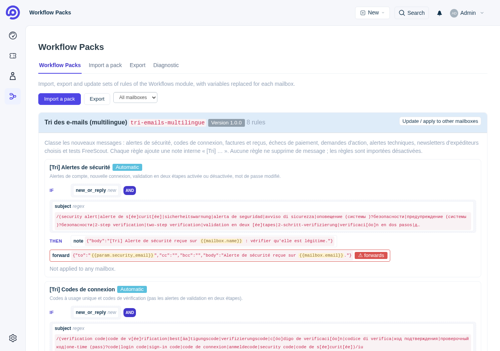
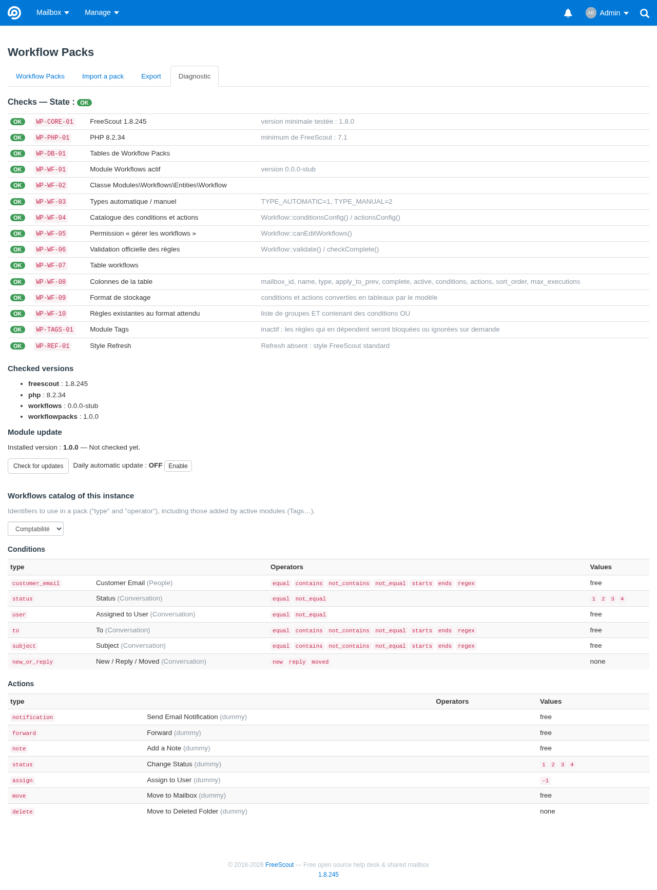
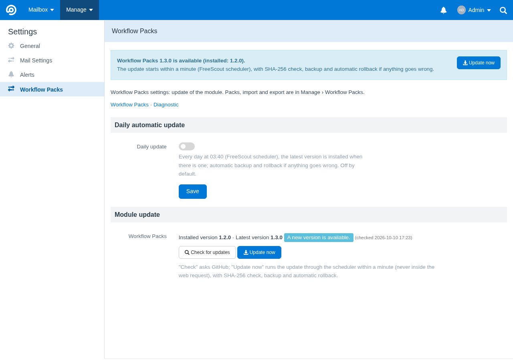

# Workflow Packs pour FreeScout

Module complémentaire de [FreeScout](https://freescout.net) qui **importe, exporte et met à jour des ensembles de règles**
du module officiel **Workflows**. Il permet d'appliquer le même tri des e-mails à plusieurs boîtes, avec des variables
remplacées pour chacune (`{{mailbox.email}}`, `{{mailbox.name}}`, `{{mailbox.id}}`, paramètres du pack).

- Le module officiel Workflows reste seul responsable de l'exécution des règles. Workflow Packs ne modifie ni le cœur
  de FreeScout ni le module Workflows.
- Un second import identique ne crée **aucun doublon** : chaque règle est identifiée par `pack.key + workflow.key + boîte`.
- Les nouvelles règles sont **désactivées** et l'application aux conversations précédentes est **désactivée** par défaut.
  L'import n'envoie aucun e-mail et ne traite aucune conversation.
- Les modifications manuelles faites depuis le dernier import sont détectées. Pour chacune, trois choix : conserver la
  version locale, la remplacer ou ignorer la règle.
- Une vue schématique (SI … ET/OU … ALORS …) présente les règles. Une matrice règles × boîtes permet de choisir, pour
  chaque boîte, ce qui sera appliqué.
- **Schéma réseau** (onglet Schéma, inspiré de draw.io) : boîtes → règles → destinations (dossiers Fermées, En
  attente, Spam, Supprimées, personnes, étiquettes, autres boîtes), avec :
  - plusieurs dispositions (colonnes, cercle, grille, libre), les déplacements étant **enregistrés en direct** ;
  - zoom sémantique et raccourcis « Aller à… » vers une partie du schéma ;
  - création et modification simples des règles (SI / ET / OU / ALORS) ;
  - application d'une règle à une autre boîte en tirant un lien.

  Voir [docs/schema.md](docs/schema.md).
- **Packs portables (format 2)** :
  - **sélecteurs de boîtes** (« toutes les boîtes », « adresse contient @example.com »…) évalués sur chaque
    installation ;
  - **ressources logiques** (`{{resource.billing-user}}`) associées par leur clé à un élément local, jamais par
    leur nom.

  Voir [docs/format.md](docs/format.md) et [docs/resources.md](docs/resources.md).
- L'interface suit le style du module **Refresh** s'il est installé, et le style standard de FreeScout sinon.
- **Téléphone** : la matrice devient une carte par règle. Avec Refresh, l'entrée du module est placée dans le
  panneau **Profil**, qui sert de menu burger, car la barre d'onglets du bas n'a pas de place libre. Sans Refresh,
  l'entrée se trouve dans le menu burger de FreeScout (Gérer).
- **7 langues**, interface et messages (validation, diagnostic, erreurs) : français, anglais, allemand, espagnol,
  italien, néerlandais, portugais (Brésil). La langue suit le profil FreeScout de l'utilisateur.
- La mise à jour automatique du module reprend le mécanisme de RefreshGlobal : version publiée, SHA-256, sauvegarde,
  vérification et retour arrière automatique.

| Schéma : flux boîtes → règles → destinations | Schéma : éditeur de règle |
|---|---|
|  |  |
| Liste des packs (vue schématique) | Prévisualisation (matrice règles × boîtes) |
|  |  |
| Avec le module Refresh | Diagnostic et catalogue Workflows |
|  |  |

> **État des vérifications.** Le module Workflows est payant et son code n'a pas pu être testé ici. Son format a été
> établi à partir de sa documentation publique et d'une copie publique partielle de son code (détails et limites dans
> [docs/analyse.md](docs/analyse.md)). Avant tout import, la commande `workflowpacks:check` vérifie sur **votre**
> instance la classe, la table, les colonnes, le catalogue et le format des règles existantes. Si un point ne
> correspond pas, l'import est bloqué avec un message clair. Ce qui est testé et ce qui reste à vérifier est détaillé
> plus bas.

## Installation

Prérequis : FreeScout ≥ 1.8.0 (testé avec 1.8.245), PHP ≥ 7.1, module officiel **Workflows** installé et activé.
Modules facultatifs : **Tags** (règles qui en dépendent) et **Refresh** (style).

### Script (recommandé)

```bash
curl -fsSLO https://raw.githubusercontent.com/00MY00/WorkflowPacks/main/install.sh
sudo bash install.sh                    # cherche FreeScout dans les dossiers par défaut, sinon demande le chemin
```

Le script enchaîne 7 étapes numérotées :

1. Vérifications : PHP, FreeScout, présence de Workflows, Refresh et Tags.
2. Sauvegarde du dossier du module et des tables `workflowpacks_*`.
3. Téléchargement du module.
4. Copie des fichiers.
5. Activation : `module:enable` et `freescout:module-install`, qui crée le lien `public/modules/workflowpacks`.
6. Migrations.
7. Contrôle avec `php artisan workflowpacks:check`.

En cas d'erreur, la version précédente du module est remise en place. Options :

- `--source fichier.zip|dossier` : installe une archive ou un dossier local ;
- `--dry-run` : affiche ce qui serait fait ;
- `--uninstall` : retire le module (les règles de Workflows restent) ;
- `--yes` : aucune question.

Si FreeScout n'est pas trouvé dans un dossier par défaut (`/var/www/html`, `/var/www/freescout`…), le script
**demande son chemin** ; avec `--yes` (sans question), il faut donner `--path`. Messages en français ou en anglais
selon `$LANG`, ou `--lang fr|en`. Le journal est écrit dans `/tmp/workflowpacks-install-*.log` et ne contient
aucun mot de passe.

### Manuelle

```bash
cd /var/www/html
sudo -u www-data git clone https://github.com/00MY00/WorkflowPacks.git /tmp/WorkflowPacks
sudo -u www-data cp -R /tmp/WorkflowPacks/WorkflowPacks Modules/WorkflowPacks
sudo -u www-data php artisan cache:clear
sudo -u www-data php artisan module:enable WorkflowPacks
sudo -u www-data php artisan freescout:module-install workflowpacks
sudo -u www-data php artisan workflowpacks:check
```

Le module apparaît dans **Gérer › Workflow Packs**, dans le menu de chaque boîte (paramètres) et dans la barre de
Refresh. Il est accessible aux administrateurs et aux utilisateurs qui ont la permission Workflows « gérer les
workflows » sur au moins une boîte.

## Importer un pack

1. **Fichier** : envoyez un `.json`, collez son contenu ou choisissez un pack fourni (`Resources/packs/`).
2. **Validation** : format, version du schéma, structure ET/OU, regex, variables, taille et dépendances.
3. **Boîtes** : seules celles dont vous pouvez gérer les workflows sont proposées.
4. **Paramètres** du pack, par exemple une adresse de notification.
5. **Prévisualisation** : règles résolues pour chaque boîte, matrice règles × boîtes avec un choix par case, et statut
   de chaque case : création, mise à jour, inchangée, conflit, conflit de nom, supprimée, bloquée ou non autorisée.
   Les différences sont affichées avant/après. Les actions sensibles sont signalées : envoi, transfert, suppression,
   changement de boîte.
6. **Options** :
   - activer les nouvelles règles (non par défaut) ;
   - respecter le réglage « conversations précédentes » du pack (non par défaut) ;
   - état actif des règles mises à jour (conservé par défaut).
7. **Confirmation** : le plan est recalculé et comparé à la prévisualisation. S'il a changé entre-temps, rien n'est
   écrit et une nouvelle prévisualisation est affichée.

**Atomicité** : tout l'import, toutes boîtes confondues, s'exécute dans **une seule transaction**. En cas d'erreur,
rien n'est enregistré : ni règle, ni lien de suivi, ni historique.

Les règles bloquées ne sont jamais importées partiellement. C'est le cas, par exemple, quand le module Tags est absent,
qu'un type est inconnu, qu'un utilisateur n'existe pas ou que la validation officielle de Workflows refuse la règle.
Aucune action n'est retirée en silence. Pour importer le reste, il faut cocher explicitement « ignorer les règles
bloquées ».

## Mettre à jour un pack

Importez la nouvelle version du fichier, ou utilisez « Mettre à jour / appliquer à d'autres boîtes » depuis la liste.
Les boîtes et les paramètres du dernier import sont repris. Les paramètres « sensibles » ne sont jamais conservés.

| Situation | Statut | Choix (défaut en premier) |
|---|---|---|
| Règle absente de la boîte, nom libre | création | créer · ignorer |
| Une règle étrangère au pack porte ce nom | conflit de nom | ignorer · créer sous un autre nom (la règle étrangère n'est jamais modifiée) |
| Identique au pack | inchangée | — |
| Non modifiée depuis le dernier import, le pack a changé | mise à jour | mettre à jour · ignorer |
| Modifiée dans Workflows depuis le dernier import | conflit | conserver la version locale · remplacer · ignorer |
| Supprimée de Workflows depuis le dernier import | supprimée | ignorer · recréer |

- Une règle absente du nouveau fichier n'est **jamais supprimée**.
- « Conserver la version locale » fait de la version locale la nouvelle référence : le prochain import la compare au
  pack. « Ignorer » ne change rien, et la question reviendra au prochain import.
- La détection compare une empreinte du nom, du type, du nombre maximal d'exécutions, des conditions et des actions.
  L'état actif, « conversations précédentes » et l'ordre restent sous votre contrôle.

## Exporter

- **Un pack importé** : le modèle d'origine est exporté tel quel, avec ses variables.
- **Une sélection de règles** d'une boîte :
  - les règles issues d'un pack sont exportées avec leur modèle d'origine ;
  - pour les autres, vous indiquez explicitement les textes à remplacer par une variable ou par un nouveau paramètre.
    Rien n'est deviné : une adresse identique à celle de la boîte reste telle quelle si vous ne la listez pas. Dans
    une regex, la forme échappée (`support@exemple\.test`) est aussi remplacée.
- **Rapport d'export** :
  - références locales à résoudre à l'import : utilisateurs (assigner, notifier, condition « assigné à ») et boîtes
    (déplacer) ;
  - types fournis par d'autres modules (Tags, champs personnalisés…), à déclarer dans `requires` ;
  - secrets retirés : mot de passe, jeton, clé, URL signée et chaînes aléatoires longues sont remplacés par un
    paramètre `sensible` à renseigner à l'import.
- Le fichier produit est validé comme un import avant d'être proposé au téléchargement.

## Format et variables

Deux versions de schéma : **1** (inchangée) et **2**. La v2 ajoute `mailboxes`, `resources` et les extensions
`x-…` dans les règles. Les packs v1 restent importés tels quels, et l'export reste en v1 tant qu'aucune fonction v2
n'est utilisée.

Le format est décrit dans [docs/format.md](docs/format.md) et le schéma JSON dans
[schema/freescout-workflow-pack.schema.json](schema/freescout-workflow-pack.schema.json). En résumé :

```json
{
  "format": "freescout-workflow-pack", "version": 1, "key": "mon-pack", "name": "Mon pack",
  "params": [{ "key": "notify", "type": "email", "required": true, "label": "Adresse de notification" }],
  "workflows": [{
    "key": "factures", "name": "[Tri] Factures", "type": "automatic",
    "settings": { "apply_to_prev": false, "max_executions": 1 },
    "requires": [],
    "conditions": { "all": [
      { "type": "new_or_reply", "operator": "new" },
      { "any": [
        { "type": "subject", "operator": "regex", "value": "/(facture|invoice)/iu" },
        { "type": "to", "operator": "regex", "value": "/^{{mailbox.email}}$/i" }
      ] }
    ] },
    "actions": [
      { "type": "note", "value": { "body": "Facture reçue sur {{mailbox.name}}" } },
      { "type": "forward", "value": { "to": "{{param.notify}}", "body": "" } }
    ]
  }]
}
```

- `all` = ET, `any` = OU. Seule la forme « ET de groupes OU » est acceptée, car c'est la seule que Workflows sait
  évaluer. Un ET placé dans un OU est refusé avec une explication.
- Les variables sont des noms simples : aucune expression n'est évaluée (ni PHP, ni JavaScript). Une variable
  inconnue, ou un paramètre obligatoire vide, bloque l'import. `{{mailbox.id}}` seul garde le type entier.
- Dans une regex, la valeur est insérée comme texte littéral (`preg_quote`). Dans les corps HTML (note, réponse,
  transfert), elle est échappée.
- Les identifiants de types et d'opérateurs disponibles sur votre instance, y compris ceux ajoutés par Tags ou
  d'autres modules, sont listés dans **Diagnostic › Catalogue Workflows**.

## Pack d'exemple : tri multilingue

[`WorkflowPacks/Resources/packs/tri-emails-multilingue.json`](WorkflowPacks/Resources/packs/tri-emails-multilingue.json)
contient 8 règles :

- alertes de sécurité ;
- codes de connexion ;
- factures et reçus ;
- échecs de paiement ;
- demandes d'action ;
- alertes techniques ;
- newsletters d'un expéditeur explicitement renseigné ;
- tests FreeScout.

Chaque règle ajoute une note interne « [Tri] … ». Les alertes de sécurité sont aussi transférées à l'adresse
renseignée à l'import (action signalée comme sensible). Seuls les tests FreeScout et l'expéditeur de newsletter choisi
sont fermés. Aucune règle ne supprime de message, et toutes sont importées désactivées.

Sujets reconnus (tests unitaires) :

- `Security alert` et `2-Step Verification turned on` → alertes de sécurité ;
- `Google Verification Code` → codes de connexion ;
- `Чек + (1) подарок. 1 384,61 ₽` → document comptable, malgré la promotion, et jamais fermé ;
- `[Action Advised] Review Google Calendar events…` → action demandée ;
- `FreeScout Email de test` → tests FreeScout.

« noreply », « cadeau » ou un lien de désabonnement ne suffisent jamais à fermer un message.

Le pack n'utilise que des actions natives de Workflows. Le module Tags ajoute ses propres identifiants, que la copie
publique analysée ne contient pas : pour classer par étiquettes, consultez le catalogue de votre instance
(Diagnostic), puis ajoutez les actions Tags et `"requires": ["tags"]`.

## Mise à jour du module

Les mises à jour se font depuis **Gérer › Paramètres › Workflow Packs**, réservé aux administrateurs. La page a la même
présentation que RefreshGlobal :

- la section « Mise à jour automatique » avec son interrupteur et le bouton Enregistrer ;
- la section « Mise à jour du module » avec la version, l'état et les boutons.

Le même bloc apparaît dans **Diagnostic**. Dès qu'une version plus récente est trouvée, un bandeau « Workflow Packs X
est disponible » s'affiche, avec un bouton **Mettre à jour maintenant**. Il est visible par les administrateurs sur
les pages du module et dans les réglages.



Le bouton est traité par le planificateur de FreeScout (cron `schedule:run` chaque minute). Comptez **1 à 2
minutes**, car le premier passage peut être occupé par la file d'e-mails de FreeScout.

La mise à jour directe vers la dernière version est testée depuis 1.0.0, 1.1.0 et 1.2.0, par la commande, le bouton
et `install.sh`. Ce test est relancé automatiquement après chaque release ; voir `tests/update/last-run.md`.

Trois actions :

- « Rechercher une mise à jour » ;
- « Mettre à jour maintenant » : exécuté par le planificateur de FreeScout dans la minute, jamais pendant une requête
  web ;
- mise à jour automatique quotidienne, désactivée par défaut.

En ligne de commande : `php artisan workflowpacks:update [--check|--enable|--disable|--force]`.

Déroulement d'une mise à jour :

1. Lecture de `module.json` de la dernière version publiée.
2. Contrôle SHA-256 de l'archive. Sans version publiée, l'archive de la branche `main` est utilisée.
3. Sauvegarde du dossier du module et des tables.
4. Installation.
5. Contrôle avec `workflowpacks:check`.
6. Si l'installation échoue ou si l'état est pire qu'avant, **retour arrière automatique** : migrations annulées,
   dossier et tables restaurés. Une version annulée n'est pas retentée automatiquement.

Les numéros de version suivent `module.json` (actuellement **1.2.2**) ; voir [CHANGELOG.md](CHANGELOG.md).

## Limites

- **Module Workflows réel non testé** : le format a été établi à partir d'une copie publique partielle datée de
  janvier 2024 (version du module inconnue, la dernière publiée étant 1.0.96). `workflowpacks:check` vérifie la
  structure sur votre instance, mais pas la sémantique de chaque condition.
- **Tags** : identifiants non connus à l'avance (voir le catalogue de l'instance).
- **Comportement de Workflows** : Workflows supprime les espaces en début et en fin des valeurs saisies dans son
  formulaire, pas Workflow Packs. Ses regex sont sensibles à la casse sans le modificateur `i`.
- **Noms** : 75 caractères au plus, uniques par boîte (règle de Workflows).
- **Ordre des règles** : les nouvelles règles sont placées en dernier (`setSortOrderLast()` de Workflows).
- **Langues** : 7 langues (fr, en, de, es, it, nl, pt-BR) ; une langue absente utilise l'anglais. Le script
  d'installation parle français ou anglais.
- **Désinstallation** : `--uninstall` supprime les tables de suivi. Les règles créées restent dans Workflows mais ne
  sont plus reconnues comme issues d'un pack ; un nouvel import les signalera en « conflit de nom ».

## Tests

| Série | Commande | Résultat |
|---|---|---|
| Unitaires (sans FreeScout) | `php tests/unit/run.php` | 37 tests, 3 909 assertions (dont les 7 langues), PHP 7.1, 8.2 et 8.4 en CI |
| Intégration (FreeScout réel + bouchon Workflows) | `bash tests/integration/run.sh` | 44 tests, 337 assertions (dont 7 pour le schéma réseau) |
| Schéma JSON (Ajv) | `node tests/schema/validate.js` | packs v1 et v2 valides, 11 variantes |
| Dispositions du schéma réseau | `node tests/js/layout.test.js` | 7 tests (ordre, alignement, aucun chevauchement) |
| Script d'installation | voir [tests/RESULTS.md](tests/RESULTS.md) | installation, mise à jour, retour arrière, désinstallation |

Détails, versions et ce qui reste à vérifier sur une vraie instance : [tests/RESULTS.md](tests/RESULTS.md).

## Contributeurs

- [@00MY00](https://github.com/00MY00) — auteur et mainteneur

## Licence

AGPL-3.0, comme FreeScout.
