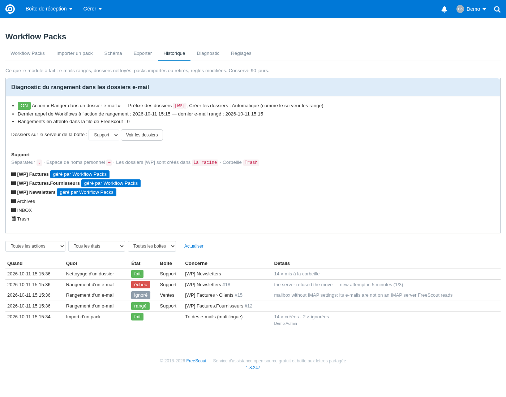

# Ranger les e-mails dans des dossiers de la boîte e-mail

Option de Workflow Packs (1.4.0), **désactivée par défaut**. Elle ajoute aux règles Workflows l'action **« Ranger dans
un dossier e-mail [WP] »**.

Quand une règle s'applique, l'e-mail reçu est **déplacé sur le serveur de messagerie (IMAP)**, par exemple de la
boîte de réception vers `[WP] Factures/Fournisseurs`. Le dossier est créé s'il n'existe pas. La boîte e-mail reste
ainsi rangée quand on l'ouvre dans Outlook, Thunderbird ou un webmail. **Le ticket dans FreeScout ne change pas** :
pour lui changer de statut, l'assigner ou l'étiqueter, ajoute les actions habituelles à la même règle.

## Activer

**Gérer › Paramètres › Workflow Packs › Rangement dans les dossiers e-mail** :

| Réglage | Effet |
|---|---|
| Action « Ranger dans un dossier e-mail » | ajoute l'action au catalogue Workflows de toutes les boîtes. Si l'option est désactivée, l'action disparaît, les règles qui l'utilisent deviennent invalides pour Workflows et les déplacements en attente ne sont pas faits |
| Préfixe des dossiers (`[WP]` par défaut) | ajouté devant chaque dossier créé, pour montrer qu'il est géré par le module. Lettres, chiffres, espaces, crochets, parenthèses, `-` et `_`, 20 caractères au plus |

## Écrire le dossier dans une règle

La valeur de l'action est un chemin avec `/` entre les niveaux :

| Valeur dans la règle | Dossier sur le serveur |
|---|---|
| `Factures` | `[WP] Factures` |
| `Factures/Fournisseurs` | `[WP] Factures` › `Fournisseurs` |
| `Clients/{{mailbox.name}}` (dans un pack) | `[WP] Clients` › `Support` pour la boîte « Support » |

- Au plus 4 niveaux et 60 caractères par niveau. Accents, espaces, `&` et points sont acceptés.
- Sont refusés : `*`, `%`, `"`, `\`, les caractères de contrôle et les noms commençant par un point.
- Le préfixe ne concerne que le dossier du haut. Les sous-dossiers sont créés dedans.

Exemple de règle dans un pack :

```json
{
  "key": "factures-fournisseurs",
  "name": "Factures fournisseurs",
  "type": "automatic",
  "conditions": { "all": [ { "type": "subject", "operator": "contains", "value": "facture" } ] },
  "actions": [
    { "type": "wp_imap_folder", "value": "Factures/Fournisseurs" },
    { "type": "status", "value": "3" }
  ]
}
```

Si l'option est désactivée sur l'instance qui importe le pack, l'import l'indique sous le bouton de l'étape. Un
administrateur peut cliquer sur **« Activer l'option et actualiser »** : l'option est activée et la prévisualisation
recalculée, sans rien perdre de ce qui a été saisi. Sinon, les règles concernées restent bloquées avec le message
« l'action … est désactivée ».

## Comment ça marche

1. Workflows applique la règle et appelle l'action par son filtre d'extension `workflow.perform_action`. Le module
   Workflows n'est pas modifié.
2. Workflow Packs met le déplacement dans la **file d'attente de FreeScout**, ce qui ne ralentit jamais la réception
   des e-mails.
3. Le travail en file se connecte au serveur avec les réglages IMAP de la boîte, avec le même client que FreeScout,
   OAuth compris. Il :
   - crée les dossiers manquants, niveau par niveau ;
   - retrouve l'e-mail par son **Message-ID** dans les dossiers que FreeScout relève (boîte de réception par défaut) ;
   - le déplace avec la commande IMAP `MOVE`. Si le serveur ne la connaît pas, il copie l'e-mail puis marque
     l'original comme supprimé, sans purge (`EXPUNGE`) : les autres messages marqués supprimés dans la boîte ne sont
     pas touchés.
4. Le résultat est écrit dans le journal de FreeScout (`[WorkflowPacks] [imap]`) :
   - `moved` : e-mail déplacé ;
   - `already` : il était déjà dans le dossier ;
   - `not_found` : introuvable, par exemple déjà déplacé à la main ;
   - `failed` : le serveur ne répond pas ou refuse. Dans ce cas, le module réessaie 5 minutes plus tard, 3 tentatives
     au total.

Le délimiteur du serveur (`/` ou `.`) est détecté automatiquement. Les serveurs qui rangent tous les dossiers sous
`INBOX` (délimiteur `.`, par exemple Courier) reçoivent `INBOX.[WP] Factures`.

## Sécurité et garde-fous

- Le module n'utilise que des commandes IMAP standard : `LIST`, `CREATE`, `SUBSCRIBE`, `SEARCH`, `MOVE`, ou à défaut
  `COPY` puis marquage de l'original comme supprimé.
- Avant d'écrire quoi que ce soit, il vérifie que le dossier cible porte bien le préfixe.
- Si l'e-mail est **déjà** dans le dossier, rien n'est fait. Appliquer la règle deux fois ne crée jamais de doublon.
- Un dossier créé entre-temps (par un autre rangement ou à la main) est réutilisé.
- Les nouveaux dossiers sont **abonnés**, pour apparaître dans Outlook ou Thunderbird, qui n'affichent souvent que les
  dossiers abonnés.
- Une nouvelle tentative n'a lieu qu'en cas d'erreur temporaire (serveur injoignable ou refus). Un nom invalide ou une
  boîte sans réglages IMAP n'est jamais réessayé, et une boîte sans réception IMAP ne met rien en file.

- Désactivé par défaut, réservé aux administrateurs (réglage), et le préfixe est nettoyé à la lecture.
- Le module ne crée et ne remplit **que** des dossiers qui portent le préfixe. Il ne supprime, ne renomme et ne vide
  jamais un dossier.
- Seul le dernier e-mail du client dans la conversation est déplacé, jamais les réponses envoyées depuis FreeScout.
- Le déplacement se fait dans la boîte e-mail de la conversation, avec ses propres identifiants : aucun accès à une
  autre boîte.

## À savoir

- Avec « Appliquer aux conversations précédentes » (désactivé par défaut dans les imports), Workflows applique la
  règle aux anciennes conversations, et leurs e-mails sont alors rangés aussi.
- Si un dossier `[WP] …` fait partie des dossiers que FreeScout relève, les e-mails déplacés ne sont pas importés une
  deuxième fois : ils sont déjà lus et FreeScout reconnaît leur Message-ID.
- Testé avec un vrai serveur IMAP (GreenMail, délimiteur `.`) dans les tests d'intégration. Le comportement du module
  Workflows officiel, payant, avec une action ajoutée par filtre suit sa copie publique analysée
  ([analyse.md](analyse.md)) : à vérifier sur ton instance avec une règle de test.

## Ranger les e-mails des tickets existants

Une règle ne range que les tickets sur lesquels Workflows l'a exécutée. Les e-mails arrivés **avant** la règle, ou
pendant qu'elle était **inactive**, restent donc où ils sont. Il en va de même pour ceux **déplacés après coup** (à
la main, par un client e-mail, par un filtre du serveur). Workflows ne relance pas non plus une règle sur un ticket
déjà traité, et la condition « Nouveau » n'est jamais vraie pour un ticket qui existe déjà, même avec « tickets
existants ».

Pour ranger ces e-mails :
- dans la liste **Workflow Packs**, cocher les règles, puis **« Ranger à nouveau dans les dossiers e-mail »** ;
- ou, dans le **schéma**, sélectionner les règles, puis clic droit › **« Ranger à nouveau dans les dossiers »** (aussi
  dans le panneau de la sélection).

« Tout sélectionner » est possible : les règles sans action « Ranger dans un dossier e-mail » sont simplement
comptées et ignorées.

Ce qui se passe, en arrière-plan, boîte par boîte (100 tickets à la fois) :
- **Tickets pris :**
  - ceux qui **remplissent les conditions** d'une règle, vérifiées par Workflows lui-même. La condition « Nouveau »
    compte comme remplie, puisque chaque ticket a été nouveau un jour ; « Réponse » reste un événement ;
  - ceux que la règle **a déjà traités** (exécutions gardées par Workflows, historique du module), même si ses
    conditions ne correspondent plus, par exemple parce que la règle a fermé le ticket.
- **Plusieurs règles pour un ticket :** la dernière dans l'ordre de Workflows l'emporte, comme quand elles
  s'exécutent l'une après l'autre.
- **Seul le rangement est fait.** Les autres actions des règles (statut, assignation, transfert…) ne sont pas
  exécutées, et les compteurs de Workflows ne changent pas.
- **Recherche de l'e-mail :**
  - déjà dans son dossier : « déjà rangé », rien ne bouge ;
  - sinon, il est cherché dans la boîte de réception, puis **dans les autres dossiers** du compte ;
  - **jamais dans la corbeille** : un e-mail supprimé reste supprimé (« introuvable »).
- **Suivi dans l'onglet Historique :**
  - une ligne par boîte montre l'avancement, puis le résultat (tickets examinés, e-mails envoyés au rangement,
    ignorés) ;
  - chaque e-mail a sa ligne « rangement relancé » et, s'il a été retrouvé ailleurs, le dossier où il était.

## Suivre ce qui se passe : l'onglet Historique

**Workflow Packs › Historique** liste chaque rangement :
- « demandé » quand Workflows appelle l'action ;
- puis « rangé », « déjà rangé », « introuvable » ou « échec », avec la raison ;
- ou « ignoré » avec la raison : option désactivée, boîte sans réception IMAP, aucun e-mail du client…

En haut de la page, un **diagnostic** réservé aux administrateurs montre :
- l'état de l'option ;
- le dernier appel de Workflows ;
- les rangements en attente ou en échec dans la file de FreeScout ;
- avec **« Voir les dossiers »**, les dossiers présents sur le serveur e-mail d'une boîte (lecture seule).

| Ce que montre l'historique | Que vérifier |
|---|---|
| aucune ligne « Rangement d'un e-mail » | la règle est-elle activée, ses conditions correspondent-elles, contient-elle l'action ? |
| « ignoré » | la raison affichée (option, boîte sans IMAP…) |
| « demandé » qui ne change jamais | la tâche planifiée (cron) de FreeScout, qui traite la file d'attente |
| « échec » | la raison du serveur ; un nouvel essai est fait automatiquement |
| « introuvable » alors que l'e-mail est dans la boîte | le lien **« Tester »** de la ligne (voir ci-dessous) |

**« Tester la recherche d'un ticket »** (administrateurs, dans le diagnostic, ou lien « Tester » d'une ligne
« introuvable ») montre, sans rien modifier, comment l'e-mail du ticket est cherché sur le serveur :
- le Message-ID connu de FreeScout ;
- chaque méthode essayée dans chaque dossier, avec la réponse du serveur :
  - recherche par Message-ID ;
  - la même recherche sans jeu de caractères ;
  - lecture des en-têtes des e-mails reçus autour de la date du ticket ;
- le dossier où l'e-mail a été trouvé ;
- les derniers e-mails de la boîte de réception avec leur Message-ID.

Si l'e-mail n'est trouvé par aucune méthode, comparer son Message-ID avec ceux de la liste. Un Message-ID absent de
la liste veut dire que FreeScout ne relève peut-être pas le même compte e-mail que celui ouvert dans le client
e-mail.

Le réglage **« Créer les dossiers »** (automatique, à la racine, sous INBOX) ne sert que si « Voir les dossiers »
montre les dossiers `[WP]` au mauvais endroit. Un dossier `[WP]` n'est jamais créé dans la corbeille.


