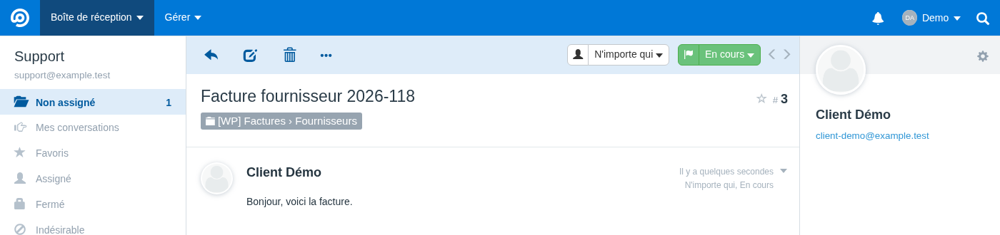
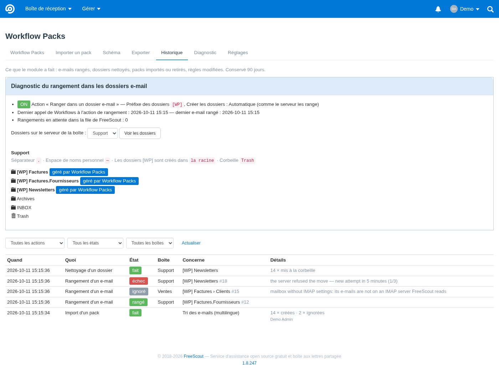

# Ranger les e-mails dans des dossiers de la boîte e-mail

Option de Workflow Packs, **désactivée par défaut**. Elle permet au bloc **« Classer dans un dossier »** des flux de
ranger l'e-mail reçu dans un dossier de la boîte e-mail.

Quand le flux arrive à ce bloc, l'e-mail est **déplacé sur le serveur de messagerie (IMAP)**, par exemple de la boîte
de réception vers `[WP] Factures/Fournisseurs`. Le dossier est créé s'il n'existe pas. La boîte e-mail reste ainsi
rangée quand on l'ouvre dans Outlook, Thunderbird ou un webmail. **Le ticket dans FreeScout ne change pas** : pour
changer son statut ou l'assigner, ajoutez les blocs habituels au flux.

## Activer

**Gérer › Paramètres › Workflow Packs › Rangement dans les dossiers e-mail** :

| Réglage | Effet |
|---|---|
| Option « Ranger dans un dossier e-mail » | permet au bloc de ranger. Désactivée, le bloc prend sa sortie « erreur » (raison dans l'Historique) et les déplacements en attente ne sont pas faits |
| Préfixe des dossiers (`[WP]` par défaut) | ajouté devant chaque dossier créé, pour montrer qu'il est géré par le module. Lettres, chiffres, espaces, crochets, parenthèses, `-` et `_`, 20 caractères au plus |

## Écrire le dossier dans le bloc

Le dossier est un chemin avec `/` entre les niveaux. L'éditeur propose les dossiers du module déjà présents sur le
serveur de l'adresse choisie.

| Dossier dans le bloc | Dossier sur le serveur |
|---|---|
| `Factures` | `[WP] Factures` |
| `Factures/Fournisseurs` | `[WP] Factures` › `Fournisseurs` |

- Au plus 4 niveaux et 60 caractères par niveau. Accents, espaces, `&` et points sont acceptés.
- Sont refusés : `*`, `%`, `"`, `\`, les caractères de contrôle et les noms commençant par un point.
- Le préfixe ne concerne que le dossier du haut. Les sous-dossiers sont créés dedans.
- **Adresse** : par défaut la boîte où l'e-mail est arrivé ; une autre boîte peut être choisie (son compte e-mail).

## Comment ça marche

1. Le flux arrive au bloc « Classer dans un dossier ».
2. Workflow Packs met le déplacement dans la **file d'attente de FreeScout**, ce qui ne ralentit jamais la réception
   des e-mails.
3. Le travail en file se connecte au serveur avec les réglages IMAP de la boîte, avec le même client que FreeScout,
   OAuth compris. Il :
   - crée les dossiers manquants, niveau par niveau ;
   - retrouve l'e-mail par son **Message-ID** dans les dossiers que FreeScout relève (boîte de réception par défaut) ;
   - le déplace avec la commande IMAP `MOVE`. Si le serveur ne la connaît pas, il copie l'e-mail puis marque
     l'original comme supprimé, sans purge (`EXPUNGE`) : les autres messages marqués supprimés dans la boîte ne sont
     pas touchés.
4. Le résultat est écrit dans le journal de FreeScout (`[WorkflowPacks] [imap]`) :
   - `moved` : e-mail déplacé ;
   - `already` : il était déjà dans le dossier ;
   - `not_found` : introuvable, par exemple déjà déplacé à la main ;
   - `failed` : le serveur ne répond pas ou refuse. Dans ce cas, le module réessaie 5 minutes plus tard, 3 tentatives
     au total.

Le délimiteur du serveur (`/` ou `.`) est détecté automatiquement. Les serveurs qui rangent tous les dossiers sous
`INBOX` (délimiteur `.`, par exemple Courier) reçoivent `INBOX.[WP] Factures`.

## Sécurité et garde-fous

- Le module n'utilise que des commandes IMAP standard : `LIST`, `CREATE`, `SUBSCRIBE`, `SEARCH`, `MOVE`, ou à défaut
  `COPY` puis marquage de l'original comme supprimé.
- Avant d'écrire quoi que ce soit, il vérifie que le dossier cible porte bien le préfixe.
- Si l'e-mail est **déjà** dans le dossier, rien n'est fait. Ranger deux fois le même e-mail ne crée jamais de doublon.
- Un dossier créé entre-temps (par un autre rangement ou à la main) est réutilisé.
- Les nouveaux dossiers sont **abonnés**, pour apparaître dans Outlook ou Thunderbird, qui n'affichent souvent que les
  dossiers abonnés.
- Une nouvelle tentative n'a lieu qu'en cas d'erreur temporaire (serveur injoignable ou refus). Un nom invalide ou une
  boîte sans réglages IMAP n'est jamais réessayé, et une boîte sans réception IMAP ne met rien en file.

- Désactivé par défaut, réservé aux administrateurs (réglage), et le préfixe est nettoyé à la lecture.
- Le module ne crée et ne remplit **que** des dossiers qui portent le préfixe. Il ne supprime, ne renomme et ne vide
  jamais un dossier.
- Seul le dernier e-mail du client dans la conversation est déplacé, jamais les réponses envoyées depuis FreeScout.
- Le déplacement se fait dans la boîte e-mail de la conversation, avec ses propres identifiants : aucun accès à une
  autre boîte.

## À savoir

- Si un dossier `[WP] …` fait partie des dossiers que FreeScout relève, les e-mails déplacés ne sont pas importés une
  deuxième fois : ils sont déjà lus et FreeScout reconnaît leur Message-ID.
- Testé avec un vrai serveur IMAP (GreenMail, délimiteur `.`) dans les tests d'intégration.

## Ranger les e-mails des tickets existants

Un flux ne range que les tickets qui y passent. Pour ranger les e-mails arrivés **avant** le flux : bouton **Tickets
existants** de l'éditeur (estimation, essai à blanc, puis traitement par lots), ou un **flux temporaire** pour une
liste de tickets (lien « Tickets sans action d'un flux… »). Voir [flux-internes.md](flux-internes.md).

## Nettoyage automatique des dossiers e-mail

**Régler (administrateurs) :** Gérer › Paramètres › Workflow Packs › **Nettoyage automatique des dossiers e-mail** :
le dossier (tel qu'écrit dans les flux, par exemple `Newsletters/Promos`), le délai (« Après 7 jour(s) ») et l'action
(« Mettre à la corbeille » ou « Supprimer définitivement »), puis **Ajouter**. La liste des nettoyages, avec un bouton
« Retirer », est juste au-dessus.

**Fonctionnement :**
- Toutes les **15 minutes**, la tâche planifiée de FreeScout (`php artisan workflowpacks:clean-folders`) passe par
  chaque boîte reçue par IMAP où le dossier existe, tant que l'option « Ranger dans un dossier e-mail » est activée.
- Les e-mails dont la date dépasse le délai sont **déplacés dans la corbeille** du compte e-mail, reconnue par son
  nom (Trash, Corbeille, Deleted Items…). Si le compte n'a pas de corbeille, ou en mode « Supprimer définitivement »,
  ils sont marqués supprimés puis purgés, **dans ce dossier seulement**.
- Au plus 500 e-mails par dossier et par passage : un gros dossier se vide en plusieurs passages.
- Chaque passage est noté dans Gérer › Journaux, sur les lignes `[WorkflowPacks] [clean-up]`.

**Garde-fous :**
- Seuls les dossiers qui portent le préfixe (`[WP] …`) sont nettoyés. Un dossier perso du même nom, ou la corbeille,
  ne sont jamais touchés.
- Un dossier qui n'existe pas encore dans une boîte n'est pas créé.
- Un e-mail sans date lisible est conservé.
- Seuls les administrateurs règlent le nettoyage, car il agit sur le serveur e-mail de toutes les boîtes.

## Dossier actuel des tickets

Workflow Packs garde, pour chaque ticket dont il a rangé l'e-mail, le dossier où se trouve cet e-mail sur le serveur.
Cette information est gardée tant que le ticket existe et effacée avec lui.

- **Dans le ticket :** une étiquette à côté du sujet, par exemple « [WP] Factures › Fournisseurs ». L'infobulle
  donne le dossier sur le serveur et la date du rangement. Si le nettoyage automatique du dossier a retiré l'e-mail,
  l'étiquette l'indique.
- **Pour les autres modules,** comme RefreshGlobal : lecture par des filtres Eventy ou par la table. Voir
  [api-dossiers.md](api-dossiers.md).

## Suivre ce qui se passe : l'onglet Historique

**Workflow Packs › Historique** liste chaque rangement :
- « demandé » quand un flux arrive au bloc ;
- puis « rangé », « déjà rangé », « introuvable » ou « échec », avec la raison ;
- ou « ignoré » avec la raison : option désactivée, boîte sans réception IMAP, aucun e-mail du client…

En haut de la page, un **diagnostic** réservé aux administrateurs montre :
- l'état de l'option ;
- le dernier rangement demandé par un flux ;
- les rangements en attente ou en échec dans la file de FreeScout ;
- avec **« Voir les dossiers »**, les dossiers présents sur le serveur e-mail d'une boîte (lecture seule).

| Ce que montre l'historique | Que vérifier |
|---|---|
| aucune ligne « Rangement d'un e-mail » | le flux est-il publié et activé, les e-mails reçus arrivent-ils au bloc (parcours d'un ticket dans l'éditeur) ? |
| « ignoré » | la raison affichée (option, boîte sans IMAP…) |
| « demandé » qui ne change jamais | la tâche planifiée (cron) de FreeScout, qui traite la file d'attente |
| « échec » | la raison du serveur ; un nouvel essai est fait automatiquement |
| « introuvable » alors que l'e-mail est dans la boîte | le lien **« Tester »** de la ligne (voir ci-dessous) |

**« Tester la recherche d'un ticket »** (administrateurs, dans le diagnostic, ou lien « Tester » d'une ligne
« introuvable ») montre, sans rien modifier, comment l'e-mail du ticket est cherché sur le serveur :
- le Message-ID connu de FreeScout ;
- chaque méthode essayée dans chaque dossier, avec la réponse du serveur :
  - recherche par Message-ID ;
  - la même recherche sans jeu de caractères ;
  - lecture des en-têtes des e-mails reçus autour de la date du ticket ;
- le dossier où l'e-mail a été trouvé ;
- les derniers e-mails de la boîte de réception avec leur Message-ID.

Si l'e-mail n'est trouvé par aucune méthode, comparer son Message-ID avec ceux de la liste. Un Message-ID absent de
la liste veut dire que FreeScout ne relève peut-être pas le même compte e-mail que celui ouvert dans le client
e-mail.

Le réglage **« Créer les dossiers »** (automatique, à la racine, sous INBOX) ne sert que si « Voir les dossiers »
montre les dossiers `[WP]` au mauvais endroit. Un dossier `[WP]` n'est jamais créé dans la corbeille.

