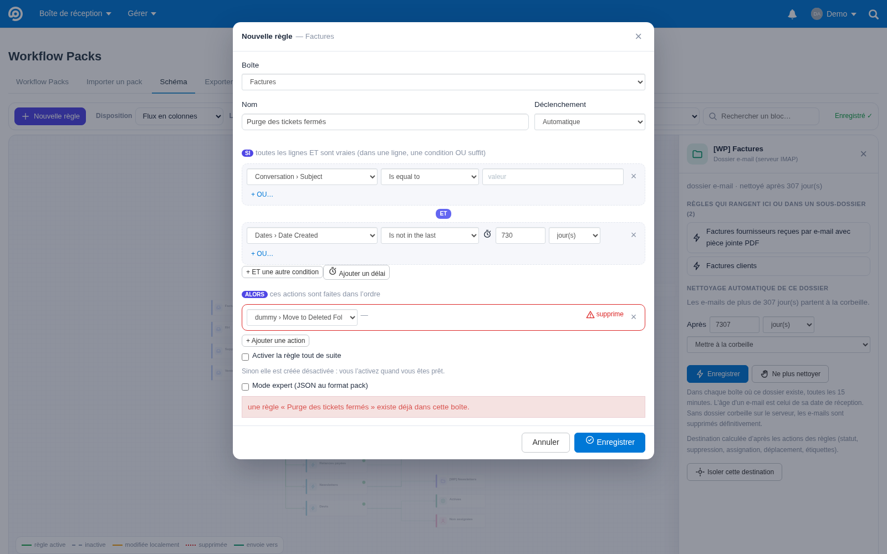

# Règles minuteur et nettoyage automatique des dossiers

Deux façons de faire agir le temps (1.9.0) :

| Besoin | Outil | Agit sur |
|---|---|---|
| « Supprimer les tickets fermés **après 30 jours** », « relancer **après 2 heures** sans réponse » | **règle minuteur** : une condition de délai dans une règle Workflows | les **tickets** dans FreeScout |
| « Les e-mails de `[WP] Newsletters` sont **supprimés après 7 jours** » | **nettoyage automatique** d'un dossier e-mail | les **e-mails** sur le serveur de messagerie |

## Règles minuteur

Workflows connaît quatre conditions de délai, qu'il revérifie régulièrement de lui-même :

| Condition | Opérateurs | Exemple |
|---|---|---|
| Date de création (`created`) | dans les derniers / pas dans les derniers | créée il y a plus de 30 jours |
| En attente depuis (`waiting`) | plus longtemps que / pas plus longtemps que | client sans réponse depuis plus de 2 heures |
| Dernière réponse d'un agent (`user_reply`) | dans les derniers / pas dans les derniers | aucune réponse d'agent depuis 3 jours |
| Dernière réponse du client (`customer_reply`) | dans les derniers / pas dans les derniers | le client n'a rien écrit depuis 14 jours |

Le délai se compose d'un nombre (de 1 à 100000) et d'une unité : minutes (`i`), heures (`h`) ou jours (`d`).

**Dans le Schéma :**
- **⏱ Ajouter un délai** dans l'éditeur ajoute « Date de création — pas dans les derniers — 7 jours ». Le nombre et
  l'unité se changent ensuite directement.
- Le bloc de la règle affiche son délai, par exemple « Après 30 jour(s) · 2 condition(s) → 1 action(s) ».

**Dans un pack :**

```json
{
  "key": "purge-fermes",
  "name": "Supprimer les tickets fermés depuis 30 jours",
  "type": "automatic",
  "settings": { "apply_to_prev": true, "max_executions": 1 },
  "conditions": { "all": [
    { "type": "created", "operator": "not_in_last", "value": { "number": 30, "metric": "d" } },
    { "type": "status", "operator": "equal", "value": "3" }
  ] },
  "actions": [ { "type": "delete" } ]
}
```

- **`delete`** met le ticket dans le dossier Supprimées de FreeScout ; **`delete_forever`** le supprime
  définitivement.
- **`apply_to_prev: true`** est nécessaire pour que la règle touche aussi les tickets déjà existants. Sinon, Workflows
  ne regarde que les tickets créés après la règle.
- Un délai mal écrit (unité inconnue, nombre invalide) bloque la règle à la prévisualisation, avec le code
  `WP-TIME-01`.
- La fréquence de vérification est fixée par le module Workflows, pas par Workflow Packs.

## Nettoyage automatique des dossiers e-mail

Il complète l'action « Ranger dans un dossier e-mail » (voir [dossiers-email.md](dossiers-email.md)).

**Régler (administrateurs) :**
1. Dans le Schéma, cliquez sur un bloc 📁 de dossier e-mail.
2. Dans la partie **« Nettoyage automatique de ce dossier »**, choisissez « Après [7] [jour(s)] » et « Mettre à la
   corbeille » ou « Supprimer définitivement », puis cliquez sur **Enregistrer**.



Le bloc du dossier affiche ensuite « nettoyé après 7 jour(s) ». La liste de tous les nettoyages, avec un bouton
« Retirer », se trouve dans Gérer › Paramètres › Workflow Packs.

**Fonctionnement :**
- Toutes les **15 minutes**, la tâche planifiée de FreeScout (`php artisan workflowpacks:clean-folders`) passe par
  chaque boîte reçue par IMAP où le dossier existe, tant que l'option « Ranger dans un dossier e-mail » est activée.
- Les e-mails dont la date dépasse le délai sont **déplacés dans la corbeille** du compte e-mail, reconnue par son
  nom (Trash, Corbeille, Deleted Items…). Si le compte n'a pas de corbeille, ou en mode « Supprimer définitivement »,
  ils sont marqués supprimés puis purgés, **dans ce dossier seulement**.
- Au plus 500 e-mails par dossier et par passage : un gros dossier se vide en plusieurs passages.
- Chaque passage est noté dans Gérer › Journaux, sur les lignes `[WorkflowPacks] [clean-up]`.

**Garde-fous :**
- Seuls les dossiers qui portent le préfixe (`[WP] …`) sont nettoyés. Un dossier perso du même nom, ou la corbeille,
  ne sont jamais touchés.
- Un dossier qui n'existe pas encore dans une boîte n'est pas créé.
- Un e-mail sans date lisible est conservé.
- Seuls les administrateurs règlent le nettoyage, car il agit sur le serveur e-mail de toutes les boîtes.
