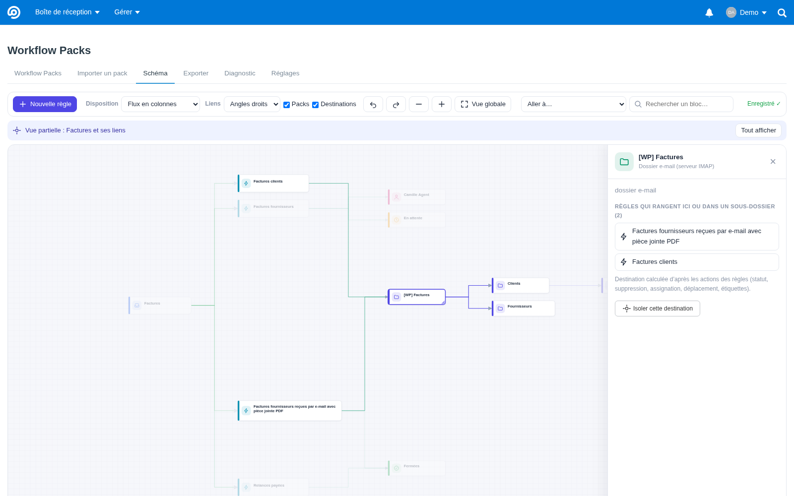
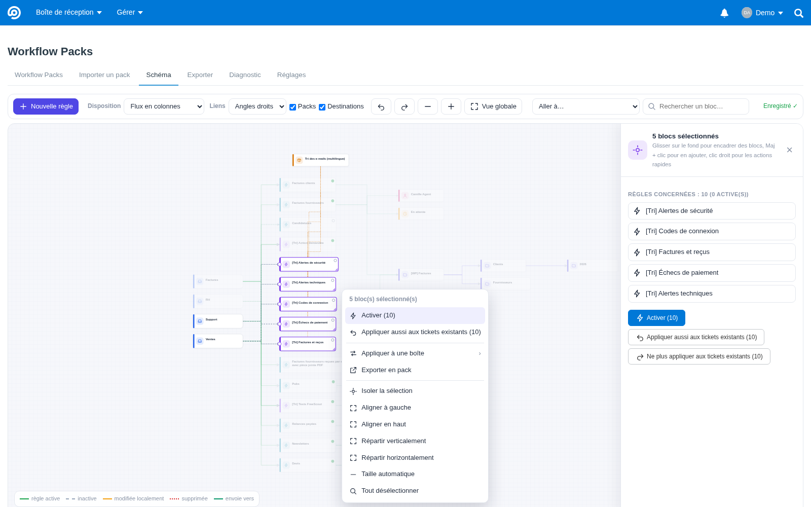
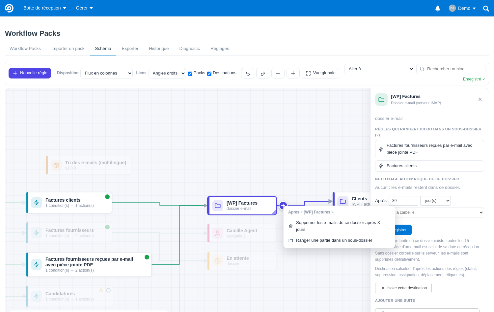
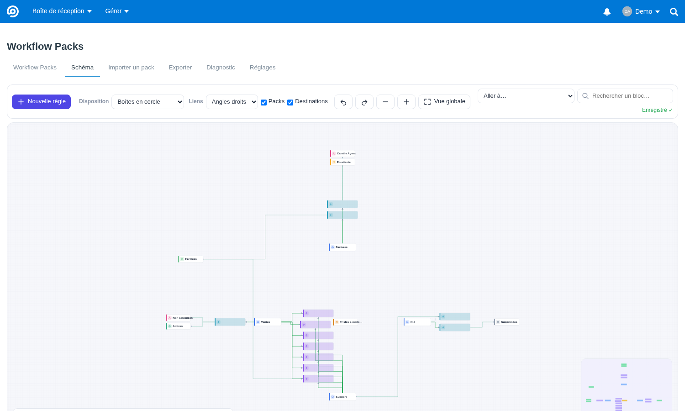
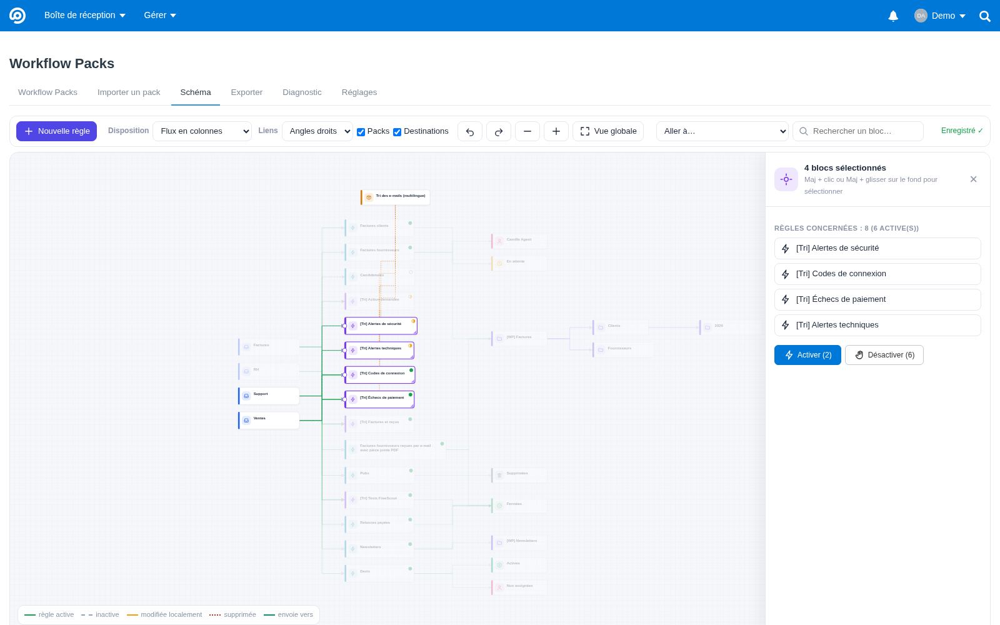
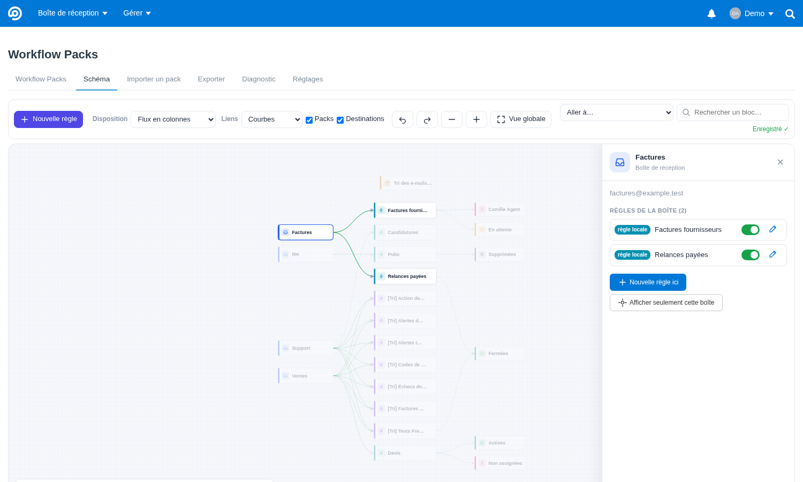
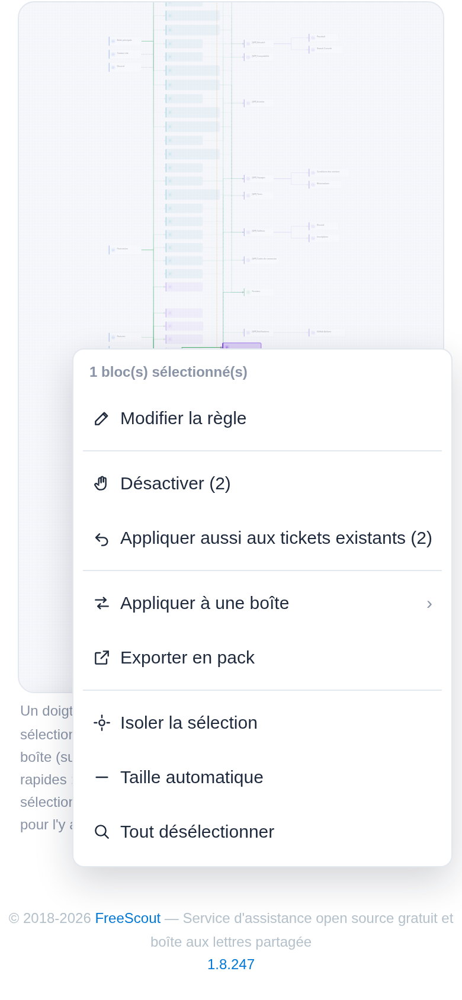

# Schéma des règles

Onglet **Workflow Packs › Schéma**. Les règles Workflows y apparaissent sous forme de réseau, comme dans draw.io :
chaque boîte de réception, chaque règle, chaque pack et chaque destination est un bloc ; les liens montrent qui
utilise quoi et où partent les conversations.

## Ce qui est affiché

| Bloc | Signification |
|---|---|
| **Boîte** (bleu) | une boîte de réception dont vous pouvez gérer les workflows ; les autres ne sont jamais envoyées au navigateur |
| **Règle** (violet : issue d'un pack, turquoise : locale) | une règle d'un pack n'a qu'**un** bloc, relié à toutes les boîtes où le pack l'a créée |
| **Pack** (orange) | pack importé ; ses liens vers ses règles apparaissent quand il est sélectionné |
| **Destination** | où la règle envoie les conversations, calculé à partir de ses actions |

Destinations reconnues :

| Action de la règle | Bloc |
|---|---|
| changer le statut | dossier **Actives**, **En attente**, **Fermées** ou **Spam** |
| supprimer / supprimer définitivement | dossier **Supprimées** |
| assigner | la **personne** (ou « Non assignées ») |
| déplacer vers une autre boîte | la **boîte** cible (son bloc si vous la gérez) |
| étiquettes (module Tags) | l'**étiquette** |

**Dossiers e-mail** (action « Ranger dans un dossier e-mail », voir [dossiers-email.md](dossiers-email.md)) :

- un bloc 📁 par niveau, en flux : la règle mène à `[WP] Factures`, puis à `Fournisseurs`, chaque sous-dossier étant
  placé dans la colonne suivante, en face de son parent ;
- le panneau d'un dossier liste les règles qui rangent dans ce dossier ou en dessous ;
- quand l'option est désactivée ou que le nom est invalide, le bloc apparaît quand même, avec un avertissement.

**État d'une règle** : symbole en haut à droite de son bloc.

| Symbole | État |
|---|---|
| rond vert plein | active dans toutes ses boîtes |
| rond gris vide | désactivée partout |
| demi-rond orange | active dans certaines boîtes seulement (le détail s'affiche au survol) |

Liens d'une règle vers une boîte :

| Trait | État |
|---|---|
| vert plein | règle active |
| gris pointillé | règle désactivée |
| orange | modifiée dans Workflows depuis l'import (le prochain import proposera de la garder ou de la remplacer) |
| rouge pointillé | supprimée de Workflows depuis l'import |

## Se déplacer

- **Se déplacer** : clic droit ou molette maintenus, ou Espace + glisser. La molette
  sert à zoomer. Sur écran tactile, voir [Téléphone et tablette](#téléphone-et-tablette). La mini-carte en bas à droite sert à sauter ailleurs.
- **Sélectionner** : glissez sur le fond avec le clic gauche pour tracer un **rectangle bleu** (Maj : ajouter à la
  sélection), ou cliquez sur un bloc (Maj + clic : en ajouter un).
- **Actions rapides** : au relâchement du rectangle, ou avec un clic droit, un menu s'ouvre à l'endroit de la souris.
  Il propose :
  - modifier ;
  - activer / désactiver ;
  - appliquer ou ne plus appliquer **aux tickets existants** ;
  - appliquer à une boîte ;
  - exporter en pack ;
  - isoler ;
  - aligner, répartir ;
  - taille automatique ;
  - désélectionner.

  
- **Vue globale** (`0`) affiche tout. Quand on s'éloigne, le zoom devient sémantique :
  - les blocs ne gardent qu'un nom court et grand ;
  - de très loin, seuls les boîtes, les packs et les destinations restent nommés, et les règles deviennent des blocs
    de couleur (vue macro).
- **Aller à…** est un raccourci vers une partie du schéma : il zoome sur une boîte, un pack ou une destination et
  n'affiche que ses liens. **Afficher tout** (`Esc`) revient au schéma complet.
- La **recherche** trouve un bloc par son nom.
- Cliquer sur un bloc met en avant ses voisins et estompe le reste. `Maj` + clic sélectionne plusieurs blocs.

## Ajouter une suite (le « + » d'un bloc)

Comme les flèches de draw.io : un bloc sélectionné affiche un **« + »** à sa droite. Il propose ce qui peut venir
après ce bloc, seulement ce que Workflows permet pour la boîte. La même liste se trouve dans le panneau du bloc
(« Ajouter une suite ») et dans ses actions rapides (« Ajouter une suite… »).

| Bloc | Suites proposées |
|---|---|
| boîte | nouvelle règle pour cette boîte ; ranger les nouveaux e-mails dans un dossier e-mail ; fermer les tickets sans réponse depuis 7 jours |
| règle | puis ranger dans un dossier e-mail, puis changer le statut, puis assigner : seulement les actions qu'elle ne fait pas encore |
| dossier e-mail | supprimer ses e-mails après X jours (administrateurs) ; ranger une partie dans un sous-dossier |
| statut (Fermées, En attente…) | mettre ces tickets à la corbeille après 30 jours sans message du client ; fermer après 7 jours sans réponse (sauf Fermées) |

Rien n'est enregistré directement :
- **Règle :** l'éditeur s'ouvre rempli, pour la compléter (un nom de dossier, par exemple), la vérifier, puis
  l'enregistrer. Une nouvelle règle est créée **désactivée** et ne s'applique pas aux tickets existants.
- **Nettoyage d'un dossier :** le panneau du dossier s'ouvre sur son réglage.

Les délais proposés (7 et 30 jours) se modifient dans l'éditeur.

## Disposer les blocs

| Disposition | Principe |
|---|---|
| **Flux en colonnes** | boîtes → règles → destinations, packs au-dessus ; chaque boîte et chaque destination est placée en face de ses règles pour limiter les croisements |
| **Boîtes en cercle** | boîtes sur un cercle, règles d'une seule boîte à l'extérieur près d'elle, règles partagées à l'intérieur entre les boîtes concernées, destinations sur un anneau extérieur |
| **Grille** | grille compacte, par type puis par nom |
| **Libre** | vos positions seulement |

Chaque bloc prend la **taille de son texte**, et un texte long passe à la ligne : rien n'est jamais coupé. La
**poignée** dans le coin inférieur droit d'un bloc permet de l'agrandir, et un double-clic dessus rend la taille
automatique.

Chaque bloc déplacé ou agrandi est **enregistré aussitôt** (indicateur « Enregistré ✓ ») pour votre compte. Les autres
utilisateurs gardent leur propre schéma. Choisir une disposition replace les blocs, et `Ctrl+Z` / `Ctrl+Y` annulent ou
rétablissent les déplacements. Les liens peuvent être à angles droits, courbes ou droits, et les packs comme les
destinations peuvent être masqués.

## Créer et modifier des règles

- **Nouvelle règle** (`N`) crée une règle dans la boîte sélectionnée. **Double-clic** sur une règle ouvre l'éditeur.

  

- L'éditeur reprend la logique de Workflows :
  - **SI** : chaque ligne **ET** doit être vraie, et dans une ligne une seule condition **OU** suffit ;
  - **ALORS** : les actions sont exécutées dans l'ordre.

  Les listes viennent du catalogue Workflows de la boîte : conditions, opérateurs, valeurs, personnes et boîtes. Le
  **mode expert** affiche la règle en JSON au format pack.
- Une nouvelle règle est créée **désactivée**, sauf si vous cochez « Activer la règle tout de suite ».
- **Appliquer à une autre boîte** : tirez le ● à gauche d'une règle jusqu'à une boîte, ou utilisez « Appliquer aussi
  à » dans le panneau. La règle y est créée désactivée.
  - Pour une règle de pack, seule cette règle est importée, avec les variables de la nouvelle boîte, et elle reste
    suivie par le pack.
  - Pour une règle locale, c'est une copie, renommée si le nom est déjà pris.
- L'interrupteur du panneau active ou désactive une règle. Une règle incomplète ne peut pas être activée.
- **Plusieurs à la fois** : sélectionnez plusieurs blocs avec le rectangle (glisser sur le fond) ou Maj + clic. Le panneau
  propose alors **Activer (n)** et **Désactiver (n)** pour toutes les règles concernées : une règle sélectionnée dans
  toutes ses boîtes, une boîte sélectionnée avec toutes ses règles.

  
- Modifier une règle de pack la fait passer en « modifiée localement ». Le prochain import du pack proposera de
  conserver votre version ou de la remplacer.

## Sécurité

- Le serveur vérifie tout, comme pour un import :
  - format du pack ;
  - catalogue Workflows de la boîte ;
  - validation officielle de Workflows ;
  - nom unique dans la boîte ;
  - permission « gérer les workflows » pour chaque boîte touchée.

  Une boîte ou une règle d'une boîte non autorisée est refusée, même avec une requête forgée.
- Les écritures passent par le modèle officiel Workflows, dans une transaction, avec le jeton CSRF de FreeScout.
- Rien n'est jamais supprimé depuis le schéma.
- Les positions sont limitées et contrôlées : clés de blocs connues, coordonnées bornées, choix d'affichage dans une
  liste fixe. Elles sont stockées dans `workflowpacks_layouts`, une ligne par utilisateur.

## Téléphone et tablette

Sur un écran tactile, le schéma suit les gestes habituels, comme dans une application de cartes :

| Geste | Effet |
|---|---|
| un doigt glissé | se déplacer ; après un geste rapide, le schéma continue sur sa lancée puis ralentit |
| deux doigts écartés ou rapprochés | zoomer autour des doigts (et se déplacer en même temps) |
| toucher un bloc ou un lien | le sélectionner (panneau en bas de l'écran) ; toucher le fond : plus rien de sélectionné |
| toucher deux fois | modifier une règle, isoler une boîte ; sur le fond : zoomer |
| appui long sur un bloc | actions rapides (comme le clic droit) |
| appui long sur le fond, puis glisser | rectangle de sélection, puis actions rapides |
| glisser un bloc **sélectionné** | le déplacer (un bloc non sélectionné déplace la vue, pour pouvoir parcourir un schéma plein) |
| tirer le ● d'une règle sélectionnée vers une boîte | l'appliquer à cette boîte (zone de toucher élargie) |
| coin en bas à droite d'un bloc sélectionné | l'agrandir |

Sur un téléphone, la barre d'outils se replie et la mini-carte est masquée. Le panneau d'un bloc s'ouvre **en bas
de l'écran**, sur la moitié de la hauteur, et le schéma reste visible au-dessus. Les menus et boutons sont plus
grands, et l'aide sous le schéma décrit les gestes tactiles.

## Code

| Fichier | Rôle |
|---|---|
| `Public/js/graph/next.js` | « Ajouter une suite » : ce qui peut suivre chaque bloc (fonction pure testée avec Node), puis l'éditeur pré-rempli |
| `Public/js/graph/gestures.js` | calculs des gestes tactiles (pincement, élan, toucher, double toucher), testés avec Node |
| `Services/Graph/GraphBuilder.php` | blocs et liens, limités aux boîtes autorisées ; destinations déduites des actions |
| `Services/Graph/RuleEditor.php` | détail, catalogue, création / modification, activation, application à une autre boîte |
| `Services/Graph/RuleCodec.php` | règle Workflows → règle au format pack (partagé avec l'export) |
| `Services/Graph/LayoutStore.php` | positions et choix d'affichage par utilisateur, mises à jour partielles |
| `Http/Controllers/GraphController.php` | page + points d'accès JSON |
| `Public/js/graph/layout.js` | dispositions automatiques (fonctions pures, testées avec Node : `node tests/js/layout.test.js`) |
| `Public/js/graph/model.js` | état du schéma, annuler / rétablir |
| `Public/js/graph/view.js` | rendu SVG, déplacement, zoom sémantique, liens à tirer |
| `Public/js/graph/inspector.js`, `editor.js`, `minimap.js`, `icons.js` | panneau, éditeur, mini-carte, icônes au trait |
| `Public/js/graph/app.js` | assemblage : chargement, enregistrement en direct, barre d'outils, raccourcis |
